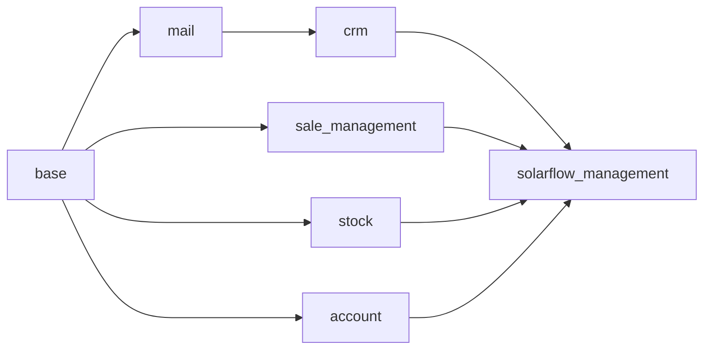

# SolarFlow ERP – System Architecture & Module Design

## 1. Executive Summary
**SolarFlow ERP** is an enterprise-grade Solar Installation Management System built on **Odoo 20 Community** (with backward-compatible support for Odoo 18/17 Community). It orchestrates the complete solar EPC (Engineering, Procurement, Construction) lifecycle:

$$\text{Customer Enquiry} \longrightarrow \text{Lead Qualification} \longrightarrow \text{Site Survey} \longrightarrow \text{Auto-BOM} \longrightarrow \text{Milestone Sales Order} \longrightarrow \text{Serialized Dispatch} \longrightarrow \text{Commissioning} \longrightarrow \text{Warranty} \longrightarrow \text{AMC}$$

---

## 2. Technology Stack

- **Core ERP Platform**: Odoo 20 Community Edition (Python 3.12, Werkzeug, Jinja2)
- **Database**: PostgreSQL 15 / 16 with persistent volume storage
- **Backend Architecture**: Odoo ORM (OpenObject Model Registry, Domain filters, Onchange & Depends decorators)
- **Frontend / UI**: Odoo Standard XML Views (Form, Tree/List, Kanban, Pivot, Graph, Search), QWeb Templating Engine
- **Deployment**: Docker & Docker Compose with multi-container service isolation
- **Version Control**: Git & GitHub repository tracking

---

## 3. High-Level Architecture Diagram

```mermaid
graph TD
    Client[Web Browser / Mobile PWA] -->|HTTP / HTTPS: 8069| Nginx[Reverse Proxy / Odoo Web]
    Nginx -->|WSGI| Odoo[Odoo 20 Community Application Server]
    
    subgraph Odoo Core Modules
        Partner[res.partner - Customers & Vendors]
        CRM[crm.lead - Lead & Opportunity Management]
        Sale[sale.order - Sales Quotations & Invoicing]
        Stock[stock.picking & stock.lot - Inventory & Serials]
        Account[account.move - Milestone Invoicing]
    end

    subgraph SolarFlow Management Extension (solarflow_management)
        SF_Lead[Solar CRM Extension: Bill Analysis & Feasibility]
        SF_Survey[solarflow.survey - Rooftop Engineering Survey]
        SF_Pkg[solarflow.package & line - Pre-engineered Packages]
        SF_BOM[Dynamic BOM Calculation Engine]
        SF_Inst[solarflow.installation - 6-Phase Commissioning]
        SF_Wrt[solarflow.warranty - Digital 25-Yr Certificates]
        SF_Svc[solarflow.service.ticket - After-Sales & AMC]
        SF_Cost[solarflow.project.cost - Job Costing & Profitability]
    end

    Odoo --> CRM
    CRM --> SF_Lead
    SF_Lead --> SF_Survey
    SF_Survey --> SF_Pkg
    SF_Pkg --> SF_BOM
    SF_BOM --> Sale
    Sale --> SF_Inst
    SF_Inst --> Stock
    SF_Inst --> SF_Wrt
    SF_Inst --> SF_Cost
    SF_Inst --> SF_Svc

    Odoo -->|TCP: 5432| Postgres[(PostgreSQL 15 Database)]
    Odoo -->|Filestore| Volumes[Docker Persistent Volume: /var/lib/odoo]
```

---

## 4. Module Dependency Structure



### Module Responsibilities:
1. **`crm` (`crm.lead`)**: Extended with solar capacity sizing, utility tariff calculations, roof parameters, and survey workflow triggers.
2. **`sale_management` (`sale.order`)**: Extended with government subsidy calculations (e.g. PM Surya Ghar scheme), solar equipment lines, and 5-stage milestone payment schedules.
3. **`stock` (`stock.picking`, `stock.lot`)**: Reused for warehouse staging, packing slip verification, and serialized tracking of PV panels, inverters, and battery banks.
4. **`account` (`account.move`)**: Reused for milestone invoicing and payment receipts.
5. **`solarflow_management` (Custom Module)**: Houses custom models (`solarflow.survey`, `solarflow.package`, `solarflow.installation`, `solarflow.warranty`, `solarflow.service.ticket`, `solarflow.project.cost`) and custom menus.
