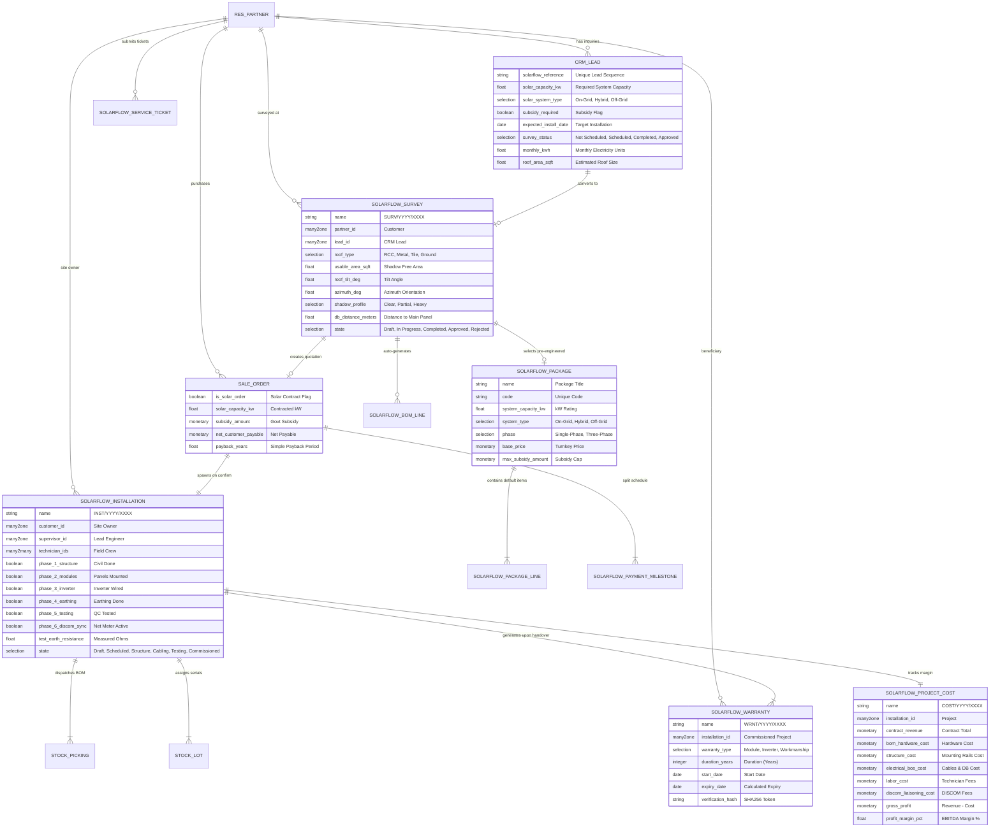

# SolarFlow ERP – Database Relationship & ER Diagram

## 1. Entity-Relationship Diagram (ERD)

---

## 2. Model Relationship Matrix

| Source Model | Field Name | Target Model | Relation Type | On Delete | Purpose |
| :--- | :--- | :--- | :--- | :--- | :--- |
| `crm.lead` | `survey_ids` | `solarflow.survey` | `One2many` | Set Null | Track site surveys generated from lead |
| `solarflow.survey` | `lead_id` | `crm.lead` | `Many2one` | Set Null | Originating lead record |
| `solarflow.survey` | `partner_id` | `res.partner` | `Many2one` | Restrict | Customer receiving the survey |
| `solarflow.survey` | `package_id` | `solarflow.package` | `Many2one` | Restrict | Selected pre-engineered package |
| `solarflow.survey` | `bom_line_ids` | `solarflow.bom.line` | `One2many` | Cascade | Calculated Bill of Materials items |
| `sale.order` | `survey_id` | `solarflow.survey` | `Many2one` | Set Null | Survey baseline for quotation |
| `sale.order` | `milestone_ids`| `solarflow.payment.milestone` | `One2many` | Cascade | 5-stage milestone payment lines |
| `solarflow.installation` | `sale_order_id`| `sale.order` | `Many2one` | Restrict | Financial sales order reference |
| `solarflow.installation` | `technician_ids`| `res.users` | `Many2many` | Null | Field crew assigned to project |
| `solarflow.installation` | `warranty_ids` | `solarflow.warranty` | `One2many` | Cascade | Warranty certificates issued |
| `solarflow.installation` | `ticket_ids` | `solarflow.service.ticket`| `One2many` | Set Null | After-sales repair tickets |
| `solarflow.installation` | `cost_id` | `solarflow.project.cost` | `Many2one` | Cascade | Financial costing sheet |
| `solarflow.warranty` | `customer_id` | `res.partner` | `Many2one` | Restrict | Warranty beneficiary |
