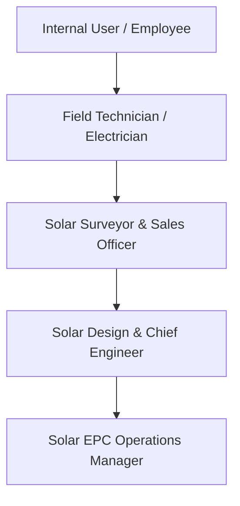

# SolarFlow ERP – Security & Access Control Design

## 1. Role-Based Access Control (RBAC) Architecture

SolarFlow ERP defines four hierarchical security groups under the category **Solar EPC Operations**:

---

## 2. Security Roles & Responsibilities

| Role Group | Technical Identifier | Functional Scope |
| :--- | :--- | :--- |
| **Field Technician** | `group_solarflow_technician` | View assigned installation projects, check off execution phases, log electrical test parameters ($V_{oc}, I_{sc}, \Omega$), update service tickets. |
| **Sales & Surveyor** | `group_solarflow_user` | Create & qualify customer leads, perform rooftop site surveys, generate dynamic BOMs, issue sales quotations. |
| **Project Engineer** | `group_solarflow_engineer` | Review and approve/reject site surveys, modify engineering BOM templates, inspect electrical test logs. |
| **EPC Manager** | `group_solarflow_manager` | Full administrative control: package pricing, financial costing sheets, gross margin oversight, user allocations. |

---

## 3. CRUD Access Control Matrix (`ir.model.access.csv`)

| Model | Model Name | Technician | Sales / Surveyor | Project Engineer | EPC Manager |
| :--- | :--- | :---: | :---: | :---: | :---: |
| `solarflow.survey` | Rooftop Site Survey | Read / Write | Read / Write / Create | Read / Write / Create | Full CRUD |
| `solarflow.package` | Pre-Engineered Package | Read | Read | Read | Full CRUD |
| `solarflow.bom.line` | Dynamic BOM Line | Read | Read / Write / Create | Read / Write / Create | Full CRUD |
| `solarflow.installation` | Installation Project | Read / Write | Read / Write / Create | Read / Write / Create | Full CRUD |
| `solarflow.warranty` | Digital Warranty Card | Read | Read / Write / Create | Read / Write / Create | Full CRUD |
| `solarflow.service.ticket`| After-Sales Ticket | Read / Write | Read / Write / Create | Read / Write / Create | Full CRUD |
| `solarflow.project.cost` | Job Costing & Margin | No Access | No Access | Read / Write | Full CRUD |
| `solarflow.payment.milestone`| Payment Milestones | No Access | Read / Write / Create | Read / Write / Create | Full CRUD |
