# SolarFlow ERP – Business Workflow Diagram & Execution Pipeline

```mermaid
flowchart TD
    %% Stage 1: Lead
    A["Customer Lead / Inquiry<br/>crm.lead<br/>(Bill analysis, roof sizing, subsidy)"] --> B["Action: Schedule Site Survey"]

    %% Stage 2: Survey
    B --> C["Site Survey<br/>solarflow.survey<br/>(Azimuth, pitch, shadow, DB distance)"]
    C --> D{"Engineering Review"}
    D -- Rejected --> D1["Rejection Wizard<br/>(Mandatory Reason Recorded)"]
    D -- Approved --> E["Approved Survey<br/>(state = approved)"]

    %% Stage 3: Auto-BOM & Package
    E --> F["Solar Package Selection<br/>solarflow.package<br/>(1kW to 5kW On-Grid / Hybrid / Off-Grid)"]
    F --> G["Automatic BOM Generation<br/>(Dynamic component pricing, zero hardcoding)"]

    %% Stage 4: Sales Quotation
    G --> H["Sales Order Quotation<br/>sale.order<br/>(PM Surya Ghar subsidy, 5-stage milestones)"]
    H --> I{"Customer Advance<br/>Payment Gate"}
    I -- Advance &lt; 50% --> I1["Dispatch Blocked<br/>(payment_status = unpaid/partial)"]
    I -- Advance &ge; 50% --> J["Dispatch Permitted<br/>(dispatch_permission = True)"]

    %% Stage 5: Inventory & Dispatch
    J --> K["Serialized Hardware Allocation<br/>stock.lot<br/>(Single active allocation constraint)"]
    K --> L["Warehouse Dispatch Validation<br/>stock.picking<br/>(Payment verified & serials assigned)"]

    %% Stage 6: Field Installation
    L --> M["Field Installation Scheduling<br/>solarflow.installation<br/>(Technician assignment mandatory)"]
    M --> N["Installation Readiness Score<br/>(Survey 20 + Payment 20 + Stock 20 + Equip 20 + Tech 20 = 100)"]
    N --> O["6-Phase Commissioning Checklist<br/>(Structure, Modules, Inverter, Earthing, Testing, Grid Sync)"]

    %% Stage 7: QC Testing & Handover
    O --> P["Electrical QC Testing<br/>(Voc &gt; 0, Isc &gt; 0, Earth Pit Resistance &le; 5.0 &Omega;)"]
    P --> Q{"Testing &amp; Sign-off Checks"}
    Q -- Earth &gt; 5.0 &Omega; or No Sign-off --> Q1["Completion Blocked by System"]
    Q -- Earth &le; 5.0 &Omega; + Customer Sign-off --> R["Project Completed &amp; Accepted<br/>(state = completed)"]

    %% Stage 8: Warranties & Costing
    R --> S["Automatic Digital Warranties<br/>solarflow.warranty<br/>(Inverter 2yr, Battery 2yr, Panel 20yr, SHA-256)"]
    R --> T["Automated Project Cost Sheet<br/>solarflow.project.cost<br/>(Estimated vs Actual, Gross Margin %)"]

    %% Stage 9: After-Sales Service
    S --> U["After-Sales Service Ticket<br/>solarflow.service.ticket<br/>(Serial lookup, auto-warranty detection)"]
    U --> V{"Fault Category"}
    V -- OEM Defect (Covered) --> W["Free Repair: Customer Charge $0.00"]
    V -- External Grid Surge / Physical --> X["Billable Repair: Parts + Labour Charged"]
    W --> Y["Customer Sign-Off &amp; Close Ticket"]
    X --> Y

    %% Stage 10: Profit Leakage Alerting
    T --> Z{"Cost Overrun &gt; Threshold %?"}
    Z -- Overrun &gt; 10% --> Z1["Profit Leakage Alert Triggered<br/>(Notifies Director &amp; Solar Manager)"]
    Z -- Within Budget --> Z2["Healthy EBITDA Gross Margin"]
```

---

## Stage-by-Stage Business Rules & Enforcement Points

### 1. Customer Lead Management (`crm.lead`)
- **Reference Generation:** Unique sequential reference `SF/LEAD/YYYY/XXXX`.
- **Validation:** Enforces valid contact numbers and email format.
- **Sizing Calculator:** Computes recommended capacity from monthly kWh consumption:
  $$\text{Recommended kW} = \frac{\text{Monthly Consumption (kWh)}}{120}$$

### 2. Site Survey Management (`solarflow.survey`)
- **Strict Approval Gate:** A survey cannot be approved without mandatory physical site attributes (roof area $>0$, usable area $>0$, cable distance $>0$, roof condition specified).
- **Mandatory Rejection Reason:** A survey cannot be rejected without documenting the technical rejection reason.
- **Role Restriction:** Only Design Engineers and Operations Managers can approve or reject surveys.

### 3. Solar Package & Dynamic Auto-BOM (`solarflow.package`)
- **No Hardcoded Pricing:** Pricing is dynamically derived as the exact sum of configured component unit prices.
- **Compatibility Validation:**
  - Off-Grid / Hybrid packages **must** include battery storage.
  - On-Grid packages **cannot** contain battery storage.
- **Single-Component Constraint:** Duplicate lines for the same component category are prevented.

### 4. Sales Order & Advance Payment Policy (`sale.order`)
- **Survey Gate:** Quotations cannot be created without referencing an approved survey.
- **50% Advance Policy:** Equipment dispatch permission is locked until at least 50% of the contract total is recorded as reconciled payment in accounting:
  $$\text{Dispatch Permission} = \begin{cases} \text{True} & \text{if } \text{Amount Paid} \ge 0.50 \times \text{Amount Total} \\ \text{False} & \text{otherwise} \end{cases}$$

### 5. Inventory & Serial Allocation (`stock.lot`, `stock.picking`)
- **Single Active Allocation:** An active equipment serial number (inverter, module, battery) can only be allocated to **one** installation project at a time.
- **Validation Gate:** `stock.picking` outgoing dispatch cannot be validated unless:
  1. Advance payment policy is satisfied (`dispatch_permission = True`).
  2. All tracked serial items have assigned serial numbers.

### 6. Installation & QC Commissioning (`solarflow.installation`)
- **Readiness Score:** Informational 0-100 score computed across 5 operational dimensions (Survey, Payment, Stock, Equipment, Technician).
- **Scheduling Gate:** Requires technician assignment and planned date.
- **Testing QC Gate:** Measured earth pit resistance must be $\le 5.0\,\Omega$ and $V_{oc} > 0, I_{sc} > 0$. High earth resistance ($>5\,\Omega$) strictly blocks project completion.
- **Customer Sign-Off:** Customer acceptance sign-off is mandatory before commissioning handover.

### 7. Digital Warranty Management (`solarflow.warranty`)
- **Equipment Connection:** Connected to the serialized equipment record (`stock.lot`).
- **Policy Duration:** Configurable term (e.g. Inverter: 2 years, Battery: 2 years, PV Panel: 20 years).
- **Auto-Calculated Expiry:**
  $$\text{Expiry Date} = \text{Start Date} + \text{Duration (Months)}$$
- **Duplicate Prevention:** Blocks multiple active warranties for the same serial number and coverage category.
- **Digital Integrity:** Generates an immutable SHA-256 cryptographic verification token.

### 8. After-Sales Service Management (`solarflow.service.ticket`)
- **Serial Auto-Discovery:** Entering an equipment serial automatically identifies customer, installation site, and active warranty.
- **Coverage Billing Engine:**
  - **Covered (OEM defects):** Customer payable amount $= \$0.00$.
  - **Non-Covered (external grid surge, physical trauma):** Customer payable amount $= \text{Parts} + \text{Labour}$.
- **Customer Sign-off Gate:** Ticket closure requires recorded customer confirmation.

### 9. Project Cost & Profitability Management (`solarflow.project.cost`)
- **Transparent Formulas:**
  $$\text{Total Cost} = \text{Material} + \text{Labour} + \text{Transportation} + \text{Additional Material} + \text{Other Expenses}$$
  $$\text{Gross Profit} = \text{Revenue} - \text{Total Cost}$$
  $$\text{Gross Margin (\%)} = \begin{cases} \left(\frac{\text{Gross Profit}}{\text{Revenue}}\right) \times 100 & \text{if } \text{Revenue} > 0 \\ 0.0 & \text{if } \text{Revenue} = 0 \end{cases}$$
- **Profit Leakage Alert:** If $(\text{Actual Cost} - \text{Estimated Cost}) / \text{Estimated Cost} \times 100 > \text{Threshold } (10\%)$, the system triggers automated alert activities to the Director and Solar Manager.
- **Confidentiality:** Costing sheets and gross margins are restricted to Director and Administrator roles.
