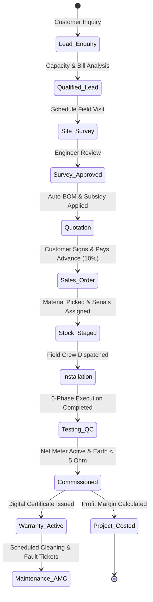

# SolarFlow ERP – Workflow State Transitions & Validation Rules

## 1. End-to-End Business Lifecycle Flow

---

## 2. Model-by-Model State Machines

### 1. `crm.lead` (Solar Opportunity)
- **States**: `new` $\rightarrow$ `qualified` $\rightarrow$ `survey_scheduled` $\rightarrow$ `won` / `lost`
- **Validation Rules**:
  - `solar_capacity_kw` must be $> 0.0$.
  - `partner_name` or `partner_id` is mandatory.
  - Generating a survey requires a valid contact address and phone number.

### 2. `solarflow.survey` (Rooftop Site Survey)
- **States**: `draft` $\rightarrow$ `in_progress` $\rightarrow$ `completed` $\rightarrow$ `approved` $\rightarrow$ `rejected`
- **Validation Rules**:
  - Survey cannot be marked `completed` unless all mandatory checklist flags (Roof Strength, Meter Box, Earthing Yard) are marked `True`.
  - Survey cannot be `approved` unless `usable_area_sqft` $> 0$ and `roof_type` is specified.
  - Quotation generation is locked until state is `approved`.

### 3. `sale.order` (Solar Proposal & Milestones)
- **States**: `draft` $\rightarrow$ `sent` $\rightarrow$ `sale` (Confirmed) $\rightarrow$ `done` / `cancel`
- **Validation Rules**:
  - Milestone percentages must sum exactly to $100\%$:
    1. Booking Advance: 10%
    2. Engineering Design: 20%
    3. Material Staging / Dispatch: 50%
    4. Installation Done: 15%
    5. Net Meter & Commissioning: 5%
  - Order confirmation automatically spawns `solarflow.installation` record.

### 4. `solarflow.installation` (Field Project & Commissioning)
- **States**: `draft` $\rightarrow$ `scheduled` $\rightarrow$ `structure` $\rightarrow$ `cabling` $\rightarrow$ `testing` $\rightarrow$ `discom_sync` $\rightarrow$ `commissioned`
- **Validation Rules**:
  - Advancing from `testing` to `discom_sync` requires `test_earth_resistance_ohms` $\le 5.0\ \Omega$.
  - Handover and commissioning require all 6 phases (`phase_1` to `phase_6`) to be `True`.
  - Commissioning triggers automatic issuance of 3 digital warranty certificates (Module, Inverter, Workmanship) and creation of the `solarflow.project.cost` sheet.

### 5. `solarflow.service.ticket` (After-Sales Maintenance)
- **States**: `new` $\rightarrow$ `assigned` $\rightarrow$ `in_progress` $\rightarrow$ `resolved` $\rightarrow$ `closed`
- **Validation Rules**:
  - Replaced components under warranty must be logged with serial numbers.
